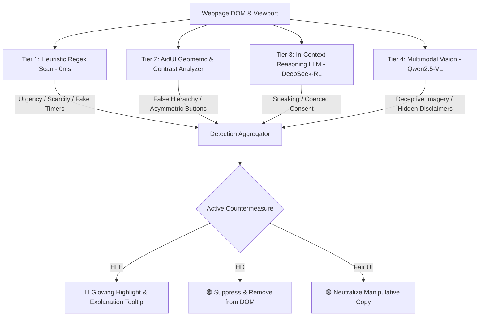

<div align="center">

# 🛡️ DarkSight v1.5.1
### Real-Time Dark Pattern Detector, Manipulative UI Countermeasure Shield & High-Performance Ad Blocker

[](https://chrome.google.com/webstore)
[](https://developer.chrome.com/docs/extensions/mv3/intro/)
[](https://github.com/gorhill/uBlock)
[](https://puter.com)
[](https://ollama.com)
[](https://ollama.com/library/deepseek-r1)
[](https://ollama.com/library/qwen2.5vl)
[](#-privacy--security)
[](LICENSE)

**DarkSight** is a dual-engine browser defense extension that detects and neutralizes deceptive design patterns (dark patterns), shields users from behavioral manipulation, and blocks intrusive advertisements, tracking scripts, and YouTube video ads in real time.

[Installation](#-installation) • [How to Use](#-how-to-use-darksight) • [Countermeasures](#-three-defensive-countermeasures) • [AI Setup](#-ai-engine-configuration) • [Architecture](#-multi-tier-hybrid-detection-architecture)

</div>

---

## 🌟 Why DarkSight?

Modern e-commerce and media platforms employ manipulative user interfaces designed to coerce users into purchases, subscriptions, or consenting to tracking. DarkSight combats this by combining **academic cognitive research** with **high-speed ad blocking**:

1. **Academic Grounding:** Implements taxonomies and algorithms from 7 landmark research papers (*Mathur et al., Schaefer et al., AidUI, DP Sentinel*).
2. **Multi-Tier Detection:** Microsecond regex heuristics + DOM geometric prominence comparison + Large Language Models (LLMs) + Multimodal Vision.
3. **Active Countermeasures:** Doesn't just report deceptive tactics—actively neutralizes them into calm, fair interfaces.
4. **Native Ad Blocking:** Integrated Manifest V3 DeclarativeNetRequest (DNR) engine equipped with official EasyList, EasyPrivacy, and uBlock filters for zero-latency blocking with zero UI collateral damage.

---

## 📖 How to Use DarkSight

DarkSight is designed to work **completely out of the box** with zero setup required. Once installed, it immediately starts protecting your browsing.

### 1️⃣ Quick Start (Out of the Box)
1. **Install and Pin:** Install DarkSight from the Chrome Web Store or load it unpacked. Pin it to your Chrome toolbar.
2. **Browse Normally:** Visit any e-commerce site (Amazon, AliExpress, Booking.com, Daraz, etc.), streaming site, or news outlet.
3. **Automatic Shielding:** DarkSight automatically:
   - Scans DOM elements and highlights deceptive countdowns, false stock limits, or manipulative buttons.
   - Silently blocks third-party ad network banners, trackers, and malicious popunders.
   - Defuses and auto-skips YouTube video ads while keeping comments and menus fully functional.

---

### 2️⃣ Understanding the Extension Popup

Click the **DarkSight shield icon** in your browser toolbar to open the control dashboard:

```
┌───────────────────────────────────────────────┐
│ 🛡️ DarkSight  v1.5.1         [AI: Online 🟢]   │
├───────────────────────────────────────────────┤
│ [ 🛡️ Countermeasures ]    [ 🚫 Ad Blocker ]    │
├───────────────────────────────────────────────┤
│ Active Mode:                                  │
│   (●) Highlight & Explain (HLE)   [🔴 Red]    │
│   ( ) Hide Deception (HD)         [🟣 Violet] │
│   ( ) Neutralize / Fair UI (SW)   [🟢 Green]  │
│                                               │
│ Live Detections on this Page:                 │
│ • Urgency Ticker detected (ends in 03:42)     │
│ • False Hierarchy: Asymmetric button pair     │
└───────────────────────────────────────────────┘
```

#### Checking AI Connection Status
In the top-right corner of the popup header, you will see a live AI diagnostic indicator:
- 🟢 **Green Tick / Online:** The AI inference engine (Cloud or Ollama) is connected and responding to queries.
- 🔴 **Red Dot / Offline:** The AI engine is unreachable or rate-limited. DarkSight's Tier 1 Heuristics and Tier 2 Geometric engines continue working locally at 100% speed.

---

### 3️⃣ Three Defensive Countermeasures

Under the **Countermeasures** tab, select how you want DarkSight to handle deceptive elements on the page:

| Mode | Icon | What It Does | Best For |
| :--- | :---: | :--- | :--- |
| **Highlight & Explain (HLE)** *(Default)* | 🔴 | Draws an animated, glowing red outline around detected elements. Hovering your mouse over the element displays an instant tooltip explaining the psychological trick. | Learning and spotting tricks while preserving original page structure. |
| **Hide Deception (HD)** | 🟣 | Automatically suppresses and removes deceptive countdown clocks, fake viewer counts, and artificial scarcity tickers from the page DOM. | Distraction-free, stress-free shopping without false urgency. |
| **Switch to Fair UI (SW)** | 🟢 | Rewrites manipulative text into calm, factual, non-coercive language (e.g., replaces *"Hurry! Only 1 item left in stock! Claim now!"* with neutral indicator *"In stock"*). | Experience ethical, honest web design. |

---

### 4️⃣ Using the Native Ad Blocker

Click the **Ad Blocker** tab in the popup to monitor and control network and cosmetic ad suppression:

- **Master Shield Toggle:** Turn ad blocking ON or OFF globally with a single click.
- **Whitelist This Site:** Toggle ad blocking OFF specifically for the current domain if you want to support a trusted publisher.
- **Live Block Metrics:** Displays real-time counts of:
  - **Network Ads Blocked:** Requests stopped before downloading (via DeclarativeNetRequest).
  - **Cosmetic Units Suppressed:** Empty ad banners and frames collapsed without page layout breakage.
- **YouTube Video Ad Skipping:** Pre-roll and mid-roll promotions on YouTube are instantly defused at the player level without altering comments, notification panels, or watch playlists.

---

### 5️⃣ Testing Engines in Developer Console

Want to test how DarkSight detects patterns on any live webpage?
1. Open Chrome DevTools (`F12` or right-click -> **Inspect**).
2. Go to the **Console** tab.
3. Type:
   ```javascript
   darkSightTestEngines()
   ```
4. Press Enter. DarkSight will run a live benchmark across all 4 detection tiers (Heuristics, Geometric Asymmetry, Cloud LLM, Multimodal Vision) and output a color-coded diagnostic report directly to the console!

---

## ⚙️ AI Engine Configuration

DarkSight supports three flexible AI inference options via the **AI Models** tab in the popup:

### Option 1: Zero-Login Cloud AI *(Default — Recommended)*
- **Setup Required:** None!
- Powered by high-speed serverless inference.
- Works 100% automatically for all users installing the extension with zero registration, zero accounts, and zero API keys.

### Option 2: Puter.js Cloud Account *(Optional)*
- For users who already have a Puter account and wish to use their own personal quota.
- Click **Connect Puter Account** in the popup to authenticate with your existing Puter token.

### Option 3: Local Offline Inference with Ollama *(Maximum Privacy)*
If you prefer running AI entirely on your own hardware without transmitting text to any remote server:

1. Install **[Ollama](https://ollama.com/download)** on your machine.
2. Pull the recommended models in your terminal:
   ```bash
   # Cognitive text reasoning model (DeepSeek-R1)
   ollama pull deepseek-r1:1.5b

   # Multimodal vision model (Qwen2.5-VL)
   ollama pull qwen2.5vl
   ```
3. Start Ollama:
   ```bash
   ollama serve
   ```
4. In DarkSight popup -> **AI Models** tab:
   - Select **Ollama (Local)**.
   - Enter your Ollama URL (default: `http://127.0.0.1:11434`).
   - Click **Test Connection** to confirm connectivity.

---

## 🧠 Multi-Tier Hybrid Detection Architecture



### Academic Research Implementations:
- **Mathur et al. (2019):** *Dark Patterns at Scale* — 7 behavioral categories (Urgency, Scarcity, Misdirection, Social Proof, Obstruction, Sneaking, Forced Action).
- **Schaefer et al. (2023):** Countermeasure paradigms (HLE, HD, Fair UI).
- **AidUI (2022):** Computer vision & geometric contrast ratio calculation for asymmetric choice architectures.
- **DP Sentinel (2024):** Multimodal detection of visual deception.

---

## 🚀 Installation

### From Source (Developer Mode)
1. Clone this repository:
   ```bash
   git clone https://github.com/tashfinn/DarkSight.git
   ```
2. Open Google Chrome and navigate to:
   ```text
   chrome://extensions/
   ```
3. Enable **Developer mode** using the toggle switch in the top-right corner.
4. Click **Load unpacked** in the top-left corner.
5. Select the cloned `DarkSight` root folder.
6. Pin **DarkSight** to your browser toolbar!

### From Release ZIP
1. Download the latest [`darksight-v1.5.1.zip`](https://github.com/tashfinn/DarkSight/releases).
2. Extract the archive into a local folder.
3. In `chrome://extensions/`, click **Load unpacked** and select the extracted folder.

---

## 📦 Project Structure

```
DarkSight/
├── manifest.json              # Chrome Manifest V3 configuration & permission boundaries
├── background.js              # Service Worker (AI router, tab metrics & webRequest listener)
├── content.js                 # DOM scanner, AidUI geometry analyzer & Countermeasure engine
├── prompt.js                  # Few-shot prompts and academic taxonomy definitions
├── yt_defuser.js              # YouTube video player ad defuser (MAIN world script)
├── adblocker.js               # Cosmetic ad filtering, gap cleaner & skip auto-clicker
├── adblock.css                # Scoped ad suppression stylesheet (zero collateral breakage)
├── popup.html / popup.js      # Extension popup UI (Countermeasures, AdBlock & AI Models)
├── popup.css / styles.css     # Dark-mode styling, glowing badges & tooltip animations
├── auth.html / auth.js        # Puter Cloud AI account manager & token validator
├── rules.json                 # Core declarative blocking rules
├── adblock_rules.json         # High-priority ad & popunder DNR rules
├── rulesets/                  # uBlock Origin Lite rulesets (EasyList, EasyPrivacy, etc.)
├── web_accessible_resources/  # Script surrogate defusers & redirect resources
├── lib/                       # Local Puter.js runtime library
├── logo/                      # Production icons (16px, 48px, 128px)
├── store_assets/              # Official Chrome Web Store screenshots & promo tile
├── package.ps1                # Automated release packager for Chrome Web Store
├── PRIVACY_POLICY.md          # Formal privacy policy documentation
└── CHROME_WEB_STORE_GUIDE.md  # Step-by-step Chrome Web Store submission guide
```

---

## 🛠️ Building & Packaging

To generate a clean production ZIP archive ready for Chrome Web Store upload:

```powershell
powershell -NoProfile -ExecutionPolicy Bypass -File package.ps1
```
The output file is created at:
```text
dist/darksight-v1.5.1.zip
```

---

## 🔒 Privacy & Security

- **Zero Tracking:** DarkSight does not track, collect, record, or sell your browsing history, searches, or keystrokes.
- **Local Sandbox Execution:** DOM scanning, contrast analysis, and cosmetic ad blocking occur entirely within your local browser sandbox.
- **Transparent AI:** You choose where inference takes place: anonymous zero-login cloud or 100% offline local hardware via Ollama.
- Review our complete [Privacy Policy](PRIVACY_POLICY.md).

---

## 📄 License

This project is licensed under the [ISC License](LICENSE).
Academic research citations and methodology references are detailed in the capstone documentation.
