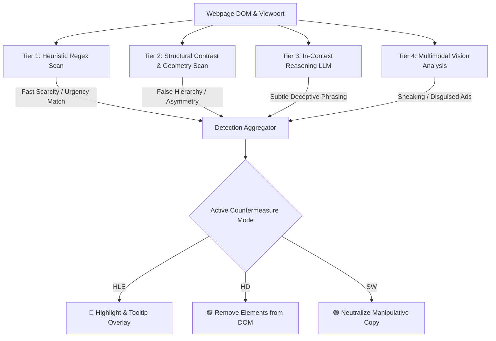

<div align="center">

# 🛡️ DarkSight
### Intelligent Real-Time Dark Pattern Detection & Countermeasures

[](https://developer.chrome.com/docs/extensions/mv3/intro/)
[](https://ollama.com)
[](https://ollama.com/library/deepseek-r1)
[](https://ollama.com/library/qwen2.5vl)
[](#-privacy--local-ai)
[](https://opensource.org/licenses/ISC)

**DarkSight** is a next-generation Chrome Extension that protects web users from coercive, deceptive, and manipulative design patterns (Dark Patterns) on modern e-commerce and shopping platforms.

Combining fast deterministic heuristics with local on-device Large Language Models (**DeepSeek-R1**) and Multimodal Vision Models (**Qwen2.5-VL**), DarkSight detects deceptive tactics in real-time and neutralizes them with active countermeasures.

</div>

---

## 📸 Overview & Countermeasures

DarkSight offers three selectable defense modes to give users complete control over their browsing experience:

| Mode | Visual | Description |
| :--- | :---: | :--- |
| **Highlight & Explain (HLE)** | 🔴 | Injects glowing warning borders around deceptive elements and provides rich contextual tooltips explaining the psychological manipulation technique. |
| **Hide (HD)** | 🟣 | Suppresses and completely removes coercive DOM elements (fake countdowns, urgency tickers) from view. |
| **Switch (SW)** | 🟢 | Automatically rewrites pressuring text into calm, neutral language (e.g., replaces *"Only 2 left! Hurry!"* with clean, informative indicators). |

---

## 🧠 Multi-Tier Hybrid Detection Architecture

DarkSight unifies seven landmark academic research frameworks into an orchestrated, real-time pipeline:



### The 4 Detection Engines:
1. **Tier 1 — Fast Heuristic Engine (Mathur et al., 2019):** Microsecond regex pattern matching across DOM nodes to capture blatant urgency, scarcity, fake discounts, and social proof.
2. **Tier 2 — Structural Visual Engine (AidUI):** Compares button bounding boxes, computed styles, color luminance, and contrast ratios to flag deceptive asymmetric button pairs (False Hierarchies).
3. **Tier 3 — Textual AI Classification (DeepSeek-R1 via Ollama):** Chain-of-thought textual reasoning to identify ambiguous deceptive phrasing (confirmshaming, forced action, disguised subscriptions).
4. **Tier 4 — Multimodal Vision Engine (Qwen2.5-VL / DP Sentinel):** Viewport snapshot analysis that visually inspects layout structures for disguised ads, sneak-into-basket, and deceptive overlays.

---

## 🔒 Privacy & Local AI Guarantee

- **100% On-Device Inference:** All AI inferences run locally on your own GPU/CPU via [Ollama](https://ollama.com).
- **Zero Cloud Transmission:** Browsing history, webpage content, DOM structures, and screenshots **never leave your machine**.
- **No Tracking:** No analytics, no telemetry, no third-party APIs.
- Read our full [Privacy Policy](PRIVACY_POLICY.md).

---

## 🚀 Quick Start Guide

### 1. Prerequisites (Local AI Setup)
DarkSight leverages local AI models via **Ollama**.

1. Download and install [Ollama](https://ollama.com/download).
2. Start Ollama and pull the recommended lightweight models in your terminal:
   ```bash
   # Text Classification Model (Chain-of-Thought reasoning)
   ollama pull deepseek-r1:1.5b

   # Multimodal Vision Model (Visual layout analysis)
   ollama pull qwen2.5vl
   ```
3. Ensure Ollama is running (`http://127.0.0.1:11434`).

---

### 2. Installing DarkSight in Google Chrome

#### Option A: Load from Source (Developer Mode)
1. Clone this repository:
   ```bash
   git clone https://github.com/tashfinn/DarkSight.git
   ```
2. Open Google Chrome and navigate to `chrome://extensions/`.
3. Enable **Developer mode** (toggle in the top-right corner).
4. Click **Load unpacked** and select the root directory of this repository.
5. Pin **DarkSight** to your toolbar!

#### Option B: From GitHub Releases (Pre-packaged ZIP)
1. Download the latest `darksight-v1.5.0.zip` from [Releases](https://github.com/tashfinn/DarkSight/releases).
2. Extract the ZIP archive into a folder.
3. Open `chrome://extensions/`, enable **Developer mode**, and click **Load unpacked**.

---

## 📦 Project Structure

```
DarkSight/
├── manifest.json              # Chrome Manifest V3 configuration
├── background.js              # Service Worker (Ollama API bridge, screenshot capture)
├── content.js                 # DOM scanner, AidUI geometry analyzer, Countermeasure injector
├── prompt.js                  # Few-shot prompts and taxonomy definitions
├── popup.html / popup.js      # Extension popup UI & live stats counter
├── popup.css / styles.css     # Dark-mode popup styling & in-page tooltip animations
├── rules.json                 # DeclarativeNetRequest rule configurations
├── logo/                      # Extension icons (16px, 48px, 128px)
├── package.ps1                # Automated packaging script for releases & Chrome Web Store
├── PRIVACY_POLICY.md          # Formal privacy policy documentation
└── tests/                     # Validation scripts, Puppeteer test suite, dataset evaluators
```

---

## 📊 Empirical Evaluation & Academic Rigor

DarkSight was evaluated against landmark research datasets:
- **Mathur et al. (Princeton Crawl):** Achieved **69.69% text recall** over 1,818 ground-truth shopping instances using on-device DeepSeek-R1.
- **AidUI (ContextDP Dataset):** Evaluated against 501 real-world e-commerce visual layouts.
- **User Evaluation Survey:** Validated across live shopping users with an average usability satisfaction score of **4.27 / 5.0**.

---

## 🛠️ Build & Package Extension

To generate a clean `.zip` archive ready for the Chrome Web Store or GitHub Releases:

In PowerShell:
```powershell
powershell -NoProfile -ExecutionPolicy Bypass -File package.ps1
```
The output file will be generated in `dist/darksight-v1.5.0.zip`.

---

## 📄 License

This project is licensed under the [ISC License](LICENSE) - see the LICENSE file for details.
